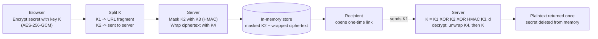

# Blink

Share secrets that disappear. Once seen, forever gone.

**Live demo: [blink.malto.icu](https://blink.malto.icu)**

Blink is a self-hosted, end-to-end encrypted secret sharing app. Paste a password or generate one, get a one-time link - the secret is deleted the moment it's opened.

## How it works

1. You enter or generate a secret
2. The secret is encrypted **in your browser** using AES-256-GCM (Web Crypto API)
3. The encryption key `K` is split into two halves: `K1` (goes in the URL fragment) and `K2` (sent to the server)
4. Neither half alone can decrypt anything - the server must participate in every reveal
5. The server masks `K2` with `HMAC-SHA256(K3, secret_id)` before storing it, where `K3` is a permanent secret that never leaves the server
6. When the recipient opens the link, the server reconstructs `K`, decrypts server-side, returns plaintext, and **immediately deletes the secret**

## Architecture



Neither `K1` nor `K2` alone can decrypt anything - the server must participate in every reveal, and `K3`/`K4` never leave the server. See [Key architecture](#key-architecture) below for what each one protects against.

## Features

- **End-to-end encrypted** - AES-256-GCM with four-factor key splitting (K1 + K2 + K3 + K4)
- **View once** - secret is deleted on first read, atomically
- **Configurable expiry** - choose 1, 6, 24, or 48 hours; unviewed secrets are automatically purged at expiry
- **Email verification (optional)** - lock a link to a specific recipient; they must enter a 6-digit code sent to their inbox to reveal the secret. Wrong code 5 times → secret self-destructs
- **Password generator** - configurable length, charset, with strength meter
- **Browser extension** - create a link from the popup, the right-click menu, or a floating button on any text selection, without opening the site (see below)
- **Light/dark theme** - defaults to light, remembers your choice
- **Rate limited** - 10 creates / 30 reads per minute per IP; 3 email OTPs per hour per IP
- **No database** - in-memory store, ephemeral by design. Both pending secrets and rate-limiter state (daily usage counts, burst windows) survive a graceful restart (a deploy) via a snapshot to disk, deleted the moment it's reloaded - but a hard crash or `SIGKILL` still loses everything in memory, by design, same as always
- **Security headers** - CSP, HSTS, X-Frame-Options, Referrer-Policy, Permissions-Policy

## Browser extension

**[Get it on the Chrome Web Store](https://chromewebstore.google.com/detail/kllkcgnchmiaopmnaokioeajmdmfccgi)** - Firefox and Edge are planned (manifest already carries a `browser_specific_settings.gecko` id for Firefox).

Same encryption model as the website - the secret is encrypted locally before anything leaves the browser - just reachable without a tab switch:

- **Popup** - create a text or password-generator link from the toolbar icon
- **Right-click menu** - select text on any page → "Send via Blink" → link copied to your clipboard
- **Floating selection button** - a small button appears next to any text you select on a page; click it for the same one-click link
- **Options page** - toggle the right-click menu and the floating button independently, pick a theme

The extension talks directly to `blink.malto.icu`'s API (`host_permissions` in `extension/manifest.json`); it needs no server-side changes and ships from the `extension/` directory in this repo, versioned separately from the web app.

## Key architecture

| Key | Lives where | Purpose |
|-----|-------------|---------|
| `K` | Browser only (never stored) | AES-256-GCM encryption key |
| `K1` | URL fragment only | Sent to server at reveal time via `X-Key` header |
| `K2` | Server memory (masked) | Stored as `K2 XOR HMAC(K3, id)` - useless without K3 |
| `K3` | Server env var only | HMAC-masks K2 at rest - never transmitted anywhere |
| `K4` | Server env var only | AES-encrypts ciphertext at rest - never transmitted anywhere |

All four factors always required to decrypt. Missing any one → decryption fails completely.

## Stack

- **Backend:** Node.js 22 + Express
- **Email:** Resend
- **Frontend:** Vanilla JS, Web Crypto API
- **Deploy:** Docker + nginx reverse proxy + Cloudflare

## Self-hosting

### Requirements

- Docker and Docker Compose
- A domain with Cloudflare (or any reverse proxy)
- A [Resend](https://resend.com) account for email OTP (optional)

### Run locally

```bash
git clone https://github.com/MALTOisHERE/onlyonce.git
cd onlyonce
npm install
node server.js
```

Open `http://localhost:3000`.

### Deploy with Docker

```bash
# Generate a permanent server secret (do this once)
echo "SECRET_KEY=$(openssl rand -hex 32)" >> .env

docker compose up -d --build
```

The container binds to `127.0.0.1:3001` - put nginx in front.

### Environment variables

| Variable | Default | Description |
|---|---|---|
| `NODE_ENV` | `development` | Set to `production` to enable HTTPS redirect and HSTS |
| `PORT` | `3000` | Port to listen on |
| `HOST` | - | Your domain (e.g. `blink.malto.icu`). Required in production |
| `SECRET_KEY` | - | K3 - HMAC-masks K2 at rest. Generate with `openssl rand -hex 32` |
| `CIPHER_KEY` | - | K4 - AES-encrypts ciphertext at rest. Generate with `openssl rand -hex 32` |
| `RESEND_API_KEY` | - | Resend API key. Required for email OTP feature |
| `EMAIL_FROM` | `Blink <noreply@malto.icu>` | Sender address (must be a verified domain in Resend) |

Copy `.env.example` to `.env` for local overrides.

### CI/CD

- **`ci.yml`**: runs automatically on every push/PR to `main` (install, lint, test, `npm audit --audit-level=high`).
- **`release.yml`**: manual only. Actions tab → "Release" → "Run workflow" → pick `patch`/`minor`/`major`. Runs lint+test first, then bumps `package.json`'s version via `npm version`, commits, tags (`vX.Y.Z`), pushes, and publishes a GitHub Release with auto-generated notes.
- **`deploy.yml`**: manual only, intentionally decoupled from releases (deploying and cutting a version are separate decisions). SSHes into the VPS and runs `git pull && docker compose up -d --build`. Needs `VPS_HOST`, `VPS_USER`, and `VPS_SSH_KEY` set as repo secrets (Settings → Secrets and variables → Actions).
- **`deploy-beszel.yml`**: manual only, separate from `deploy.yml` on purpose — the [Beszel monitoring stack](monitoring/beszel/README.md) is host infrastructure, not part of the Blink app, so it updates on its own schedule. Reuses the same three VPS secrets. See `monitoring/beszel/README.md` for the one-time setup this assumes is already done.

### nginx config

```nginx
server {
    listen 80;
    server_name blink.yourdomain.com;
    location / {
        proxy_pass http://127.0.0.1:3001;
        proxy_set_header Host $host;
        proxy_set_header X-Real-IP $remote_addr;
        proxy_set_header X-Forwarded-For $proxy_add_x_forwarded_for;
        proxy_set_header X-Forwarded-Proto $http_x_forwarded_proto;
    }
}
```

## Security model

| Threat | Mitigation |
|---|---|
| Server memory dump | `K2` stored masked with `HMAC(K3, id)` - useless without `K3` |
| Replay attack | Secret deleted from memory on first read |
| Link interception | HTTPS enforced; `K1` is in URL fragment, never in request body |
| Browser history exposure | `K1` cleared from URL via `history.replaceState` immediately on page load |
| Offline decryption | Server must participate in every reveal - ciphertext alone is not enough |
| Brute-force OTP | 5-attempt limit per secret, then self-destructs; 30 reads/min/IP |
| Email rate abuse | 3 OTP emails per hour per IP |
| Brute-force IDs | UUID v4 (122 bits entropy) + rate limiting |
| XSS | Strict CSP (`script-src 'self'`); user content set via `textContent` |
| Host header injection | HTTPS redirect uses `process.env.HOST`, not `req.headers.host` |
| Memory exhaustion | 10 000 secret cap; 1–48h TTL (user-chosen); purge interval every 60s |

## Logging

Structured logging via [pino](https://getpino.io), end to end. Every `/api/*` request gets one access-log line (method, url, status, response time, a request id, the real client IP even behind a reverse proxy); static assets and plain page loads stay quiet to avoid one line per file on every page view. Every significant action a route handler takes — secret created/viewed/destroyed, OTP sent/verified, license activated/deactivated, OAuth login, rate limits, tampered sessions — logs under that same request id regardless of path, so a single request's whole story can be traced by id, and errors are never silenced by the quiet-static-assets rule.

Every log line goes to **both**:
- the console (pretty-printed by default — set `LOG_PRETTY=false` for raw JSON), for `docker logs` / a terminal
- a rotating file under `LOGS_DIR` (defaults to `data/logs`, the same Docker volume as `stats.json`/`licenses.json`) — one file per day, gzipped after rotation, auto-deleted after 14 days, so nothing is lost across a container restart

**What never reaches a log line, regardless of `LOG_LEVEL`:** secret plaintext/ciphertext, OTP codes, passphrases, license keys, encryption keys, session cookies. Route handlers only ever log specific chosen fields (an id fragment, a boolean, a count) — never a whole `req.body` or `req.headers` object — and pino's `redact` config is a backstop for those exact field names on top of that.

## Project structure

```
blink/
├── server.js            # Express server, rate limiter, secret store, email OTP
├── lib/
│   ├── logger.js        # Structured logging (pino): console + rotating file
│   └── ratelimiter.js   # Fixed-window rate limiter
├── public/
│   ├── index.html       # Create page
│   ├── view.html        # View-once page
│   ├── about.html       # How it works & FAQ
│   ├── app.js            # Encrypt, key split, generate password, create link
│   ├── view.js           # Reveal flow, OTP flow
│   ├── about.js          # FAQ accordion
│   ├── style.css          # Light/dark theme UI
│   ├── theme-init.js      # Applies saved theme before first paint
│   ├── theme-toggle.js    # Light/dark toggle button
│   ├── version.js         # Shows the running app version in the footer
│   ├── manifest.json      # PWA manifest
│   ├── sw.js / register-sw.js  # Offline-capable service worker
│   └── fonts/              # Self-hosted woff2 files
├── extension/             # Chrome/Firefox browser extension (Manifest V3)
│   ├── manifest.json      # Permissions, content script, options page
│   ├── background.js      # Service worker: context menu, link creation, clipboard
│   ├── content.js         # Floating button on text selection
│   ├── popup.html / popup.js / popup.css    # Toolbar popup (create + password tabs)
│   ├── options.html / options.js / options.css  # Settings page (toggles, theme)
│   └── crypto.js / config.js  # Shared encryption + API config with the website
├── .github/workflows/
│   ├── ci.yml            # Lint, test, audit on every push/PR to main
│   ├── codeql.yml        # Static security analysis
│   ├── release.yml       # Manual: bump version, tag, publish a GitHub Release
│   ├── deploy.yml        # Manual: SSH deploy to the VPS (separate from release)
│   └── deploy-beszel.yml # Manual: update the Beszel monitoring stack (separate from the app deploy)
├── monitoring/
│   └── beszel/           # VPS monitoring (hub + agent), not part of the Blink app itself
├── Dockerfile
├── docker-compose.yml
└── .env.example
```

Logos and icons (`blink-logo.png`, `logo.png`, `logo-192.png`, `logo-512.png`) are not in this repo: the hosted instance at blink.malto.icu serves them from `https://assets.malto.icu/blink/`. If you self-host, either swap those URLs in `public/*.html`, `public/style.css`, and `public/manifest.json` for your own, or point them at a copy of the same files on any host that sends `Access-Control-Allow-Origin` (needed for the CSS-masked logos and the manifest icons specifically).

## License

[AGPL-3.0](LICENSE)

Blink is free software: you can use, self-host, modify, and redistribute it under the terms of the GNU Affero General Public License v3. If you run a modified version as a network service, you must make your modified source available to its users. Self-hosting is and will always be fully featured and free.
